# Claude-Code-Game-Studios 지원과 사용법

검증 범위: **Windows DEV-01의 제한된 원본 실행 + Godot 4.7.2 + Studio Provider 역할 연동**.
전체 카탈로그를 가져왔다는 이유로 74개 스킬과 모든 Shell/hook 동작을 호환 완료로 표시하지 않는다. 스킬별 지원 상태를 확인한다. 설치 패키지·설치·운영 배포는 사용자 담당이다.

## 고정된 원본

- 저장소: https://github.com/Donchitos/Claude-Code-Game-Studios
- commit: `05ad7c8a5b8aa2aa86bbd3439ae7cf7295cac418`
- manifest: `b1f58c40e2d5d01f1871af574849853f908301afc57242da0251881b6988a12f`
- MIT. 파일439개, 역할49개, 스킬74개, 훅18개, 규칙14개, workflow catalog1개.
- `resources/integrations/ccgs/<commit>/runtime-bundle.json`은 원본 바이트 전체를 base64로 보존한다. `catalog.json`은 원문·frontmatter·원본 경로·SHA-256을 보존한다.
- `original/`은 파일 열람용 사본이다. 두 파일의 줄 끝 공백41개만 정리했고 차이는 `display-normalization.json`의 원본/열람 SHA로 연결한다. 실행·전체 프롬프트는 정리된 열람 파일을 사용하지 않는다. 라이선스 문구와 실행 원문은 보존한다.
- `node scripts/import-ccgs.mjs <local-git-source>`는 고정 Git blob만 읽는다. checkout, 원본 script 실행, 자동 최신 main fetch가 없다. 기존 사용자 수정과 다른 정의는 UPDATE_CONFLICT로 거부한다. 동일 JSON의 CRLF/LF 차이는 의미 변경으로 오인하지 않는다.
- `node scripts/verify-ccgs.mjs`는 고정 신원, 모든 checksum, 원문/열람 사본 관계, 누락·중복 정의를 로컬에서 검사한다.

## 사용 순서

1. 새 프로젝트에서 Framework template을 Claude-Code-Game-Studios로 선택한다. Project kind(플랫폼)와 Game engine은 독립 선택이다. 기존 프로젝트에서는 오케스트레이션의 카탈로그에서 Link framework template을 사용한다. 연결은 metadata이며 원본 hook을 실행하지 않는다.
2. 실행 장비에서 Claude Code 2.1.296에 로그인하고 실제 Python3·Git Bash·Godot4.7.2 경로를 준비한다. WindowsApps 실행 별칭과 System32 WSL bash는 거부한다. 다른 장비의 credential을 Snapshot에 복사하지 않는다.
3. 실행 Agent의 `TASTESTUDIO_FRAMEWORK_RUNTIME`에 아래 형식의 로컬 JSON 경로를 지정한다. 고정 runner의 실제 소문자 SHA-256이 필요하다. PowerShell에서는 `(Get-FileHash <runner> -Algorithm SHA256).Hash.ToLowerInvariant()`로 구한다. 정상 구성인 Agent만 `frameworkRuntime:1`을 보고한다. 구버전 Agent에 일반 Shell로 우회하지 않는다. 인증·실제 버전은 실행 시 다시 검사한다.

```json
{"node":"C:/runtime/node.exe","runner":"C:/studio/transport/framework-agent-cli.ts","runnerHash":"<actual SHA-256>","claude":"C:/Users/<user>/.local/bin/claude.exe","python":"C:/Python/python.exe","bash":"C:/Program Files/Git/bin/bash.exe","godot":"C:/Apps/IDES/Godot/Godot_v4.7.2-stable_win64_console.exe"}
```

4. Core와 Agent를 연결하고 프로젝트 폴더를 연결한다. 카탈로그에서 필요한 역할/스킬만 선택하여 실행 Agent 노드에 연결한다. 전체 카탈로그를 자동 배치하지 않는다. 프로필30개·노드60개 제한을 유지한다. 역할의 모델·허용 도구·maxTurns와 긴 원문 프롬프트를 확인한다.
5. Read effective configuration으로 출처를 확인한다. Framework mode settings에서 rigor/automation을 변경할 수 있다. 저장 전 대상 파일과 전후 hash를 승인한다. 주석과 무관한 설정은 보존하며 모호한 YAML·Dirty Editor·stale disk 변경은 거부한다. 로컬 파일에서 rigor 변경은 금지하고 원본 whitelist를 따른다.
6. Godot Protocol 테스트를 준비한다. 아래 고정 command는 Agent가 로컬 경로/버전을 검증한 Godot으로 변환한다. 테스트 파일은 사용자가 검토한 프로젝트 Source다. AI가 임의 Shell command를 만들어 실행하지 않는다.

```yaml
# .tastedev/project.yml
version: 1
project: {name: My Game, type: generic}
requirements:
  tools: {claudeCodeFramework: true}
# .tastedev/tasks.yml
visual:
  command: internal-framework-godot
  args: [--path, ., --script, tests/visual.gd]
  timeout: 60
# .tastedev/tests.yml
movement: {task: visual, type: e2e, timeout: 90}
```

플레이어가 보는 변경은 rendered e2e 테스트가 필요하다. `--headless`만으로 통과할 수 없다. 검토한 테스트가 실제 조작을 수행하고 `.tastedev-artifacts/godot/frame.png`에 렌더링 결과를 저장해야 한다. Agent는 신선한 PNG·크기·checksum을 검사하고 기존 Evidence 전송 경로로 올린다. headless 검사와 실제 조작 증거를 구분한다.

7. Native task의 Protocol reference에는 검증할 Test를 지정한다. 스킬 인자와 격리 공간에서 수정할 파일을 명시한다. `/start`처럼 질문이 필요한 workflow는 Framework orchestrator를 선택한다. 전문 역할을 선택하면 원본 역할의 도구 제한과 모델/maxTurns가 적용된다. 모델을 지정하지 않으면 원본 정의의 상속을 유지한다.
8. 저장되지 않은 편집 내용을 처리한 뒤 Source와 실행 scope를 승인한다. 저장된 Working Tree Snapshot v2를 사용하며 HEAD만 복사하지 않는다. 비밀 파일·캐시·엔진 생성물을 제외하고 승인된 공개 프레임워크 bundle을 별도 계층으로 올린다. 프레임워크 실행 코드가 수정돼 있으면 자동 덮어쓰기 대신 충돌로 중단한다.
9. Native framework sessions에서 구조화된 질문/권한 요청에 답한다. 일반 텍스트 질문을 실제 AskUserQuestion으로 추측하지 않는다. 응답은 프로젝트·Run·workspace·세션·요청 ID·설정 hash·만료에 묶인다. 거절/취소와 인증 필요 상태를 구분한다.
9a. 모델 완료 뒤에도 Godot을 자동 실행하지 않는다. Native framework sessions의 실제 변경 Diff, Source checksum, Godot 버전과 고정 Protocol 인자를 확인하고 Approve validation으로 별도 승인한다. Reject/Cancel/만료는 실행을 막는다. 승인한 Source는 봉인되며 후속 변경·승인 재사용은 거부된다. 원본 반영 승인을 대신하지 않는다. 바이너리는 수동 검토 대상이다.
10. 실제 Agent 테스트가 통과하면 Original Diff and integration에서 변경 파일과 새 디렉터리를 확인한다. Prepare original Diff → Monaco Diff → Approve and Apply 순서다. 원본 반영 승인은 격리 실행 승인과 별도다. 실제 Git Diff도 확인할 수 있다.
11. Validate and Remote Retest로 반영된 원본의 새 Snapshot을 실제 Agent에서 재시험한다. Graph는 framework-review에서 기다린다. Continue with verified Source 승인 후에만 그 Snapshot을 후속 노드에 전달한다. 변경 없는 기획 작업은 원본 무변경 검토로 진행하며 가짜 Patch를 만들지 않는다.
12. Revert AI Changes는 전후 hash가 일치할 때만 복원한다. 이번 작업이 만든 빈 디렉터리만 정리하며 기존 폴더·사용자 추가 내용은 보존한다. 바이너리는 자동 텍스트 병합하지 않고 수동 검토로 남긴다.
13. Core/연결 중단 후 원래 Agent가 재접속하고 이전 Run이 종료되면 Resume exact native session으로 재개한다. 저장된 정확한 native session ID와 기존 격리 폴더를 사용한다. 설정/읽기 전용 Source가 달라지면 거부한다. 새 Run에서 별도 승인과 새 요청 ID를 기록하고 origin을 포함해 최대3회로 제한한다. 중단된 Run과 증거는 덮어쓰지 않는다.

## 관계와 실행 구조

```mermaid
flowchart LR
  Device[장비] --> Rust[실행 Rust Agent]
  Rust --> Role[AI 역할 노드 / 원본 workflow]
  Role --> Skill[선택한 스킬과 인자]
  Skill --> SDK[고정 Claude Agent SDK 래퍼]
  SDK <--> Session[Core FrameworkSession]
  Session <--> Questions[질문 / 권한 / 재개 승인 GUI]
  SDK --> Isolated[저장된 Working Tree 격리]
  Isolated --> ValidationReview[실제 Diff / 봉인 Source 검증 승인]
  ValidationReview --> Verify[기존 Protocol / Queue / Agent Godot 검증]
  Verify --> Diff[실제 Diff 검토]
  Diff --> Approve[별도 원본 반영 승인]
  Approve --> Patch[기존 FixService / hash precondition / directory journal]
  Patch --> Retest[원본 Snapshot 실제 재시험]
  Retest --> Adopt[새 Source 승인]
  Adopt --> Next[후속 노드]
```



AI 역할과 실행 Rust Agent는 다른 개념이다. delegates/consults/escalates는 역할 관계이며 success/failure 실행 간선과 구분한다. AI 전용 별도 Test Runner나 자동 commit/push는 없다.

## 설정·보안 계약

설정 우선순위는 inline review → 원본에서 허용한 local key → project.yaml → legacy 파일 → rigor 파생 → default/unset이다. 원본 helper의 enum·whitelist·rigor/default table을 보존한다. 엔진/언어·전문 역할·review gate·검사 강도·입력 방식의 파생 값과 technical-preferences fallback도 출처와 함께 표시한다. 원본 런타임은 원본 설정 helper를 실제로 로드한다.

SDK0.3.316을 lockfile에 고정했다. `settingSources:['project']`와 원본 Claude preset/skills/hooks를 사용하며 bare 실행은 하지 않는다. SDK callback 하나를 보안 경계로 쓰지 않는다. 명시적 tool set, PreToolUse 검사, 경로/실제 경로 검사, 승인된 writable scope, 고정 bundle checksum을 함께 사용한다. 임의 Shell·commit/push·원본 외부 Write·credential Read는 허용하지 않는다. 원본 settings의 자동 허용 규칙도 이 경계를 해제하지 못한다.

최대 tool calls120, 연속 동일 요청3회, 요청 maxTurns1~40와 원본 역할 제한 중 작은 값, 실행 timeout 최대15분을 적용한다. 인증/요청 제한/context 초과/잘못된 응답/취소/timeout/도구 제한을 구분하며 Provider 문제를 Source 결함으로 판정하지 않는다. Core가 다시 시작되면 이전 미응답 요청은 만료된다. 이미 완료된 요청이나 다른 세션의 응답은 거부한다.

## 실제 검증과 지원 표

| 범위 | 근거와 결과 |
|---|---|
| 고정 카탈로그·원문 | 439 blobs / 156 definitions checksum, 원문 바이트 보존 및 열람 사본 변환 검증 |
| 원본 실행 | 실제 Claude2.1.296 `/start` 질문·응답, `/dev-story` Godot 기능 구현 |
| Godot | 실제4.7.2 게임 실행, `ui_right` 프로그램 입력으로 이동 검증, 실제 렌더 PNG |
| Graph | Native 검증 → 원본 승인/반영 → 실제 재시험 → 승인된 새 Snapshot → 후속 테스트 PASS |
| 복구 | 실제 Core 중단/재시작, 실제 Rust Agent, 같은 native session ID·같은 격리 폴더 재개; 잘못된 ID 거부 |
| 하위 역할 | 실제 원본 godot-specialist 호출과 SubagentStart/Stop·parent tool 추적 |
| Studio Provider | 실제 gpt-6.1-sol 기획·수정 제안·독립 QA 검토, 원본 변경0 |
| 쓰기 보호 | 승인 전 원본 변경0, 기존 사용자 변경·Dummy .env 보존, 실제 rollback 및 새 빈 디렉터리 정리 |
| GUI | production 웹 + 실제 E2E DB 사본 + IPC 모사. 밝게/어둡게, 12,250자 원문, 420px Monaco Diff, 독립 플랫폼/엔진 선택 확인 |

Studio Provider는 기존 AIService/Provider와 read-only tools를 사용한다. 역할의 전체 원문을 마스킹된 context로 보내고 한도를 넘으면 명시적으로 거부한다. 원본 전용 스킬/훅을 Studio에 이식 완료로 표시하지 않는다.

실제 게임 코드는 Agent 계정 권한으로 실행된다. 이 기능은 OS 샌드박스를 제공하지 않는다. 따라서 격리 Source의 실제 Diff와 검토한 Protocol 실행을 별도로 승인하며, 신뢰할 수 없는 엔진 코드를 무인 실행하는 용도로 사용하지 않는다.

## 제한과 검증 범위

- 원본 실행 qualification은 검사한 `/start`, `/dev-story`, Godot specialist와 제한된 Protocol 경로다. 다른 스킬은 카탈로그에 보존하되 개별 qualification이 남는다. 원본의 무제한/복합 Bash 동작은 계속 차단하며 필요할 때 검토된 Protocol 작업으로 분리한다.
- Unity/Unreal은 정의·설정·준비 상태까지다. 실제 엔진 E2E는 Godot만 수행했다.
- SDK/Godot 실제 E2E는 Windows DEV-01이다. Linux/macOS의 실제 실행·서비스·설치본 GUI·설치/업데이트 시험은 수행하지 않았다.
- 프레임워크 템플릿 연결은 게임 Source나 모든 테스트를 자동 생성하지 않는다. 실행할 프로젝트의 엔진/Protocol과 테스트를 검토해 준비한다.
- 공개 프레임워크 업데이트는 새 commit/manifest를 검토해야 하며 자동 main 갱신이 없다. 변경된 config로 과거 승인을 자동 재사용하지 않는다.
- 패키징·서명·설치·배포·자동 commit/push는 수행하지 않았다. 제품 버전0.2.8을 유지했다.

검증 결과·정확한 Run/Snapshot/Proposal ID·입력/산출물 hash·잔여 제한은 `resources/verification/dev-01/ccgs-20261031/RESULT.ko.md`와 `EVIDENCE-INDEX.md`를 따른다.
