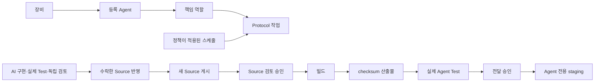

# 제품 오케스트레이션 운영

## 범위

관계도는 장비 → Agent → 역할 → 작업의 실행 책임을 나타낸다. 작업은 실제 Protocol Task/Test를 참조한다. 명시적 장비 소속만 인정하며 이름으로 물리 PC를 추정하지 않는다. Source 게시·실행·승인·배포를 서로 구분한다.

## 후속 작업 완료

Factory 작업의 Dependencies에서 선행 작업 상태와 검증한 Source checksum을 확인한다. 실제 Run과 Graph 실행으로 이동할 수 있다. 선행 작업이 수락한 변경을 현재 작업 공간에 반영한 뒤 Source Snapshot을 새로 게시한다. idle 후속 계약에서 Source를 다시 검토하고 새 queue 승인을 한다. 같은 관계도라도 Source 신원이 바뀌면 재검토가 가능하며 이전 계약과 Attempt는 유지한다. Source 바이트가 맞지 않으면 후속 실행은 차단한다.

## 장비 준비 진단

장비·역할 패널에서 선택한 장비의 명시적 Agent, 실제 책임 역할, 연결된 Protocol 작업, 작업 위치와 런타임 부족 이유를 본다. 다른 장비의 Agent가 조건을 만족하더라도 이 장비를 준비됨으로 표시하지 않는다. 이것은 로컬 사전 진단이다. 최종 권한·장비 정책·현재 상태 판정은 Core가 새 배정 시 다시 수행한다.

## 산출물 전달

실행 모니터링의 산출물 전달 상세에서 producer Run/step → consumer Agent/Run과 checksum을 확인한다. producer가 완료한 산출물은 produced, 실제 입력 설치 영수증이 있는 경우 installed, 같은 Source/실행/activation에 연결된 consumer Run이 실제 성공한 경우 verified이다. 실패한 Test의 다운로드 성공을 테스트 성공으로 표시하지 않는다. 영수증은 당시 전달 기록이며 현재 디스크 파일의 무기한 보존을 보증하지 않는다.

## 스케줄 정책

놓친 실행은 기본적으로 건너뛴다. 허용 지연 안에서 한 번 실행하는 정책을 선택하면 60–86400초의 지연 한도를 적용하고 backlog 전체를 재생하지 않는다. Protocol Test의 추가 재시도는 0–2회이며 기존 Core retryJob을 사용한다. 이전 Job/Run은 이력에 보존한다. 현재 Protocol 계획·요구사항·정책이 바뀌었거나 비활성화·중복 실행·용량 제한에 걸리면 자동 재시도를 막는다. SQLite 기록 실패 후 이미 생성된 같은 재시도 Job을 찾아 중복을 만들지 않는다. Graph/AI/배포의 승인은 자동 재생하지 않는다.

## 복구

Core 재시작 후 실행은 paused가 된다. 복구 체크리스트는 최신 Attempt별 성공 결과 유지·실패 단계·승인·Run 위치를 보여 준다. 같은 revision/graph/input/Source와 남은 기한을 확인한 뒤 검토하고 재개한다. 성공 작업을 다시 실행하지 않는다. 종료된 실패 실행은 최신 실패 activation만 명시적으로 재시도할 수 있고 새 Attempt를 만든다. 배포 실패는 즉시 선행 승인 노드로 돌아가 새 승인을 받는다. 다른 Source·입력·만료 실행은 재개하지 않고 새 실행으로 검토한다. 시작 제한 시간은 1–120분, 기본10분이며 같은 요청 신원의 기한을 늘릴 수 없다.

## TASTEFILES 초안

TASTEFILES 프로젝트를 연 뒤 오케스트레이션의 TASTEFILES 전달 초안을 펼친다. 유효한 Protocol이 없으면 플랫폼과 생성할 네 파일을 검토하고 초안을 만든다. 기존 다른 내용의 Protocol은 덮어쓰지 않는다. Native의 배타적 파일 전이를 사용하며 중간 실패 시 같은 내용의 파일은 유지하고 없는 파일만 이어 만든다. Dirty 문서나 작업 공간 변경은 차단한다.

기본 초안은 cargo desktop build, core unit Test, 산출물 검사, Agent 작업 공간 안의 승인된 staging으로 구성된다. 생성한 초안은 프로젝트 요구에 맞게 검토해야 한다. staging은 운영 장비 설치가 아니다. 빌드 Task/Test/전달 Task와 각 등록 Agent를 선택해 관계도 초안을 검토한다. Source 검토 승인 → 빌드 → 같은 산출물 Test → 전달 승인 → 전달 순서이며 기존 노드를 보존한다. Test pipeline의 build를 중복 지정할 수 없다. AI 작업이 수락한 Source를 게시한 뒤 별도 전달 실행을 시작한다. 아직 반영되지 않은 AI 수정본을 이전 Snapshot으로 빌드하지 않는다.

## Source 전송

Project Snapshot v2는 vendored 소스를 포함할 수 있다. vendor 안의 target/node_modules/.env/credential 경로는 계속 제외한다. v1 작은 텍스트 Snapshot은 종전 vendor 제외를 유지한다. 새 Agent는 v2 vendored 소스를 검증하고 구버전 Agent는 허용되지 않는 경로를 거부한다. 설치된 Agent 업그레이드는 사용자 패키징·설치 범위다.

Core의 완료 검사는 전체 파일을 검증한다. Agent manifest 요청은 완료 marker와 manifest를 검사하고, 각 blob 응답은 그 파일의 size/hash를 다시 검사한다. 모든 다운로드에서 전체 Source를 재검사하던 중복을 줄였으며 Run/프로젝트/grant/기한/범위/If-Match 검사는 유지한다.

빌드 산출물 토큰은 고정 5분이 아니라 실제 step 시작 시각+승인된 timeout과 Graph 실행 기한의 최솟값까지만 유효하다. 따라서 긴 빌드의 결과를 받을 수 있으면서, 단계 종료·취소·권한 철회·기한 만료 시 기존 토큰을 계속 사용할 수 없다.

## 확인 범위

검증 결과는 resources/verification/dev-01/product-orchestration-20261031의 최종 RESULT.ko.md와 EVIDENCE-INDEX.md를 기준으로 한다. 실제 TASTEFILES 검증은 0.2.34 CLI를 고정 Source Snapshot에서 컴파일하고 3개의 로컬 Rust Agent로 복사 Test·산출물 전달·승인된 private staging까지 수행했다. 컴파일 후 토큰 만료 실패에서는 hash가 같은 완료된 Release 바이트를 재사용해 전송부터 재개했다. CLI가 아닌 desktop GUI 빌드는 이번 실제 파일럿에 포함하지 않았다. 원본 ui-kit/settings.rs의 별도 변경1건은 보존했으며 고정 Snapshot 758개 파일은 세 Agent에서 모두 일치했다. 논리 Agent 여러 개와 물리 장비 여러 대를 구분한다. 실제 Provider·실제 Agent 실행과 synthetic Native IPC GUI 검증, Native 컴파일, 설치본 시험은 별도 근거다. 패키징·운영 장비 배포·자동 commit/push는 수행하지 않는다.

## 실행 관계

장비·Agent·역할 연결은 배정 조건이고 성공 흐름은 실행 순서다. 선이 연결됐다고 자동으로 실행하지 않는다. 승인·정책·Source·기한 조건을 모두 충족해야 기존 Core Queue/Matcher/Pipeline으로 진행한다.
